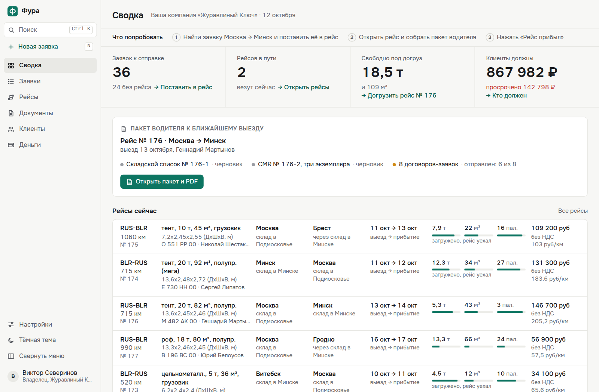

# Фура

Заявки, рейсы и документы для перевозчика сборных грузов между Россией и Беларусью.

### [Открыть систему »](https://fura.qxstay.ru)

Витрина на основе реального проекта. Данные вымышленные, вход в один клик.

## Один рейс

1. Заявка Москва → Минск встаёт в рейс, и сразу видно, сколько в машине осталось места по весу, объёму и палетам.
2. Рейс уходит в путь.
3. Пакет водителя: складской список, CMR в трёх экземплярах и договоры-заявки одним PDF.
4. «Рейс прибыл», и все заявки рейса сами становятся «На складе».

Ещё внутри: строка заявки привычна по бирже грузов (направление, кузов, вес и объём, ставка с НДС и без), документы со статусами, долги клиентов, поиск по всему, тёмная тема, курьер с телефона.

Для разработчиков: что в коде

- `src/lib/docs`: лист документа в миллиметрах. По одной модели рисуются превью в браузере и PDF: складской список, CMR и пакет водителя одним файлом.
- `src/client/store.tsx`, `router.tsx`, `src/lib/snapshot.ts`: данные приходят в браузер один раз, экраны и карточка сбоку открываются без запросов к серверу, изменения видны сразу и откатываются при ошибке.
- `src/lib/freight.ts`, `load-bars.tsx`, `pallet-plan.tsx`, `to-trip.tsx`: догруз по весу, объёму и палетам, схема палетомест сверху, рейс не перегружается.
- `src/lib/world`: вымышленный мир на каждый день и его пересборка; ИНН, УНП и счета специально не проходят контрольную сумму.
- `src/lib/geo.ts`, `city-input.tsx`, `palette.tsx`: подсказки городов (крупные первыми, Enter не берёт деревню) и поиск по всему.
- `tests`: тесты к этим частям, запускаются в полном проекте.

Полный код закрыт и показывается по запросу.

Технологии

Next.js 16, React 19, TypeScript, PostgreSQL, Prisma, pdf-lib, Playwright.

Обсудить похожую систему: [Telegram](https://t.me/qxstay)
